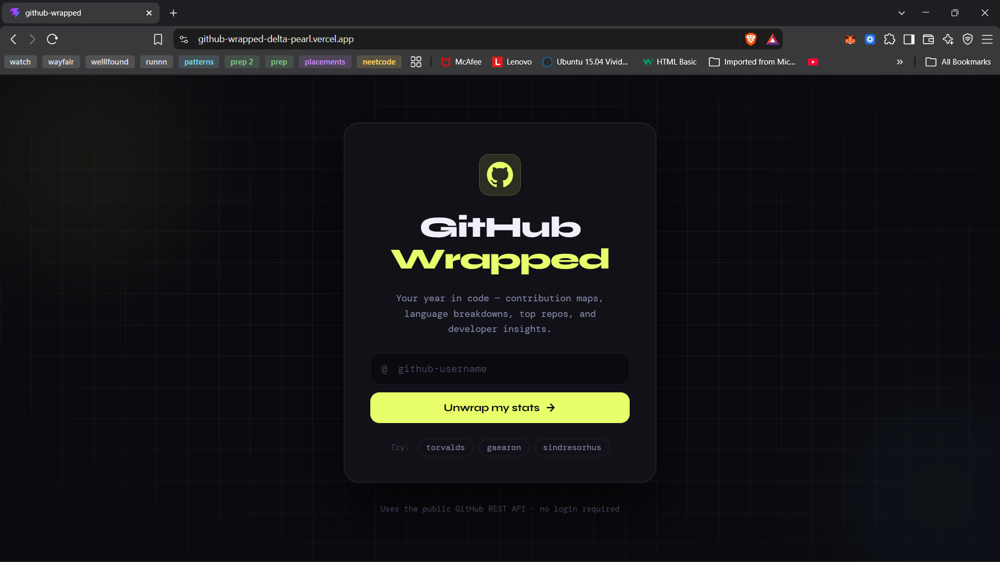

# GitHub Wrapped


> Beautiful analytics for any public GitHub profile. Type a username, get a dashboard.

**[Live demo →](https://github-wrapped-delta-pearl.vercel.app/)**



## Features

- **Profile overview**: avatar, name, bio, location, and company
- **Insights panel**: total stars, forks, repos, recent pushes, current streak, peak coding hour, followers, and following
- **Activity heatmap**: a day-by-day grid of public activity over the last 90 days
- **Language breakdown**: the share of each language, measured in bytes of code across original (non-fork) repos
- **Top repos**: the five most-starred original repositories, each linking to GitHub
- **Loading and error states**: a spinner while data loads, and a friendly message for unknown users or rate limits
- **Responsive layout** and semantic, accessible markup

## Tech stack

| Area    | Tools                                                    |
| ------- | -------------------------------------------------------- |
| UI      | React, Vite                                              |
| Routing | React Router                                             |
| Data    | GitHub REST API                                          |
| Backend | Vercel serverless function (API proxy)                   |
| Testing | Vitest                                                   |
| CI      | GitHub Actions (lint, test, build)                       |
| Styling | Plain CSS (custom properties, grid, keyframe animations) |
| Hosting | Vercel (auto-deploys on every push to `main`)            |

## Architecture

```
Browser
  │
  │  Home (search) → /dashboard/:username
  │
  ▼
useGitHubData(username)          custom hook: loading / error / success state
  │
  ▼
src/api/github.js                client cache + error handling
  │
  │  GET /api/github?path=/users/...
  ▼
api/github.js                    Vercel serverless function (server-side)
  │   • endpoint allowlist
  │   • adds GITHUB_TOKEN
  │   • edge caching (s-maxage=300)
  ▼
GitHub REST API
  │
  ▼
utils/dataHelpers.js             reshape data for the UI
  │
  ▼
ProfileHeader · InsightsPanel · ContributionHeatmap · LanguageChart · TopRepos
```

### Design decisions

- **Serverless proxy.** The browser never talks to GitHub directly. It calls `/api/github`, and a Vercel function adds the access token server-side, so no credential is shipped in the client bundle.
- **Endpoint allowlist.** The proxy only forwards four known GitHub paths (user, repos, public events, repo languages) and checks the resolved origin, so it can't be used as an open relay.
- **Two cache layers.** Responses are cached at Vercel's edge for 5 minutes (`s-maxage=300`, shared across all visitors, with `stale-while-revalidate`), and again in an in-memory `Map` on the client for repeat lookups within a session.
- **Custom hook with stale-response protection.** `useGitHubData` ignores results from outdated requests, so a slow earlier search can't overwrite a newer one.
- **Parallel requests.** Per-repo language data is fetched with `Promise.all` instead of one request after another.
- **Pure data helpers.** `utils/dataHelpers.js` contains side-effect-free functions that turn raw API data into chart-ready shapes, which keeps components simple and makes the logic easy to test.

## Testing and CI

```bash
npm test
```

- **Unit tests** cover the data helpers: heatmap day-filling, language percentages, and insight calculations including streaks and fork filtering. Time is frozen in tests so results don't depend on the day they run.
- **Proxy tests** verify the security rules: requests with no path, off-allowlist paths, and host-redirect attempts are rejected; allowed paths are forwarded with the server-side token; error responses are not cached; upstream failures return 502. `fetch` is mocked, so tests never call GitHub.
- **GitHub Actions** runs lint, tests, and a production build on every push to `main` and on pull requests.

## Project structure

```
.github/
└── workflows/
    └── ci.yml      Lint, test, and build on every push
api/
└── github.js       Serverless proxy (runs on Vercel, not in the browser)
src/
├── api/            Client-side fetching and caching
├── components/     ProfileHeader, InsightsPanel, ContributionHeatmap,
│                   LanguageChart, TopRepos, StatusScreen
├── hooks/          useGitHubData
├── pages/          Home, Dashboard
└── utils/          dataHelpers (with unit tests alongside)
tests/
└── proxy.test.js   Tests for the serverless proxy
```

## Run locally

```bash
git clone https://github.com/Lakshita301/github-wrapped.git
cd github-wrapped
npm install
```

The data requests go through the serverless function in `api/`, which `npm run dev` does not run. Use the Vercel CLI instead:

```bash
npm i -g vercel
vercel login
vercel link
vercel dev
```

Then open the local URL it prints (usually `http://localhost:3000`).

### Optional: add a GitHub token

Without a token, GitHub allows 60 API requests per hour. With one, the limit is 5,000.

1. Create a token at [github.com/settings/tokens](https://github.com/settings/tokens) (classic, with **no scopes selected**, since only public data is read).
2. Create a `.env` file in the project root:

```
GITHUB_TOKEN=your_token_here
```

3. Restart `vercel dev`.

The token has no `VITE_` prefix on purpose. Vite exposes `VITE_` variables to the browser, while `GITHUB_TOKEN` is only readable by the serverless function.

## Deployment

Deployed on Vercel with automatic deploys from `main`. Setup needs:

- A `GITHUB_TOKEN` environment variable in the Vercel project settings (Production and Preview)
- A `vercel.json` rewrite so client-side routes like `/dashboard/torvalds` don't 404 on refresh, while leaving `/api/*` alone:

```json
{
  "rewrites": [{ "source": "/((?!api/).*)", "destination": "/index.html" }]
}
```

## Known limitations

- **90-day window.** GitHub's public events API only returns roughly the last 90 days of activity, so the heatmap and streak cover that period rather than a full year.
- **Pushes, not commits.** Insights count push events, because the events API doesn't reliably include individual commits.
- **Peak hour uses the viewer's timezone**, not the profile owner's.
- **One request per repo for languages.** Profiles with very many repos use many API calls per lookup.
- Languages are measured per repository by bytes, so very small shares can round to 0%.

## Roadmap

- [x] Serverless proxy to keep the token server-side
- [x] Edge caching shared across visitors
- [x] Unit tests (Vitest) and a GitHub Actions CI pipeline
- [ ] Full-year contribution graph using the GitHub GraphQL API
- [ ] Limit language lookups to the most recently active repos
- [ ] Compare two profiles side by side
- [ ] Shareable PNG card

## Author

Built by [Lakshita](https://github.com/Lakshita301) while learning React, hooks, REST APIs, serverless functions, and CI/CD.
